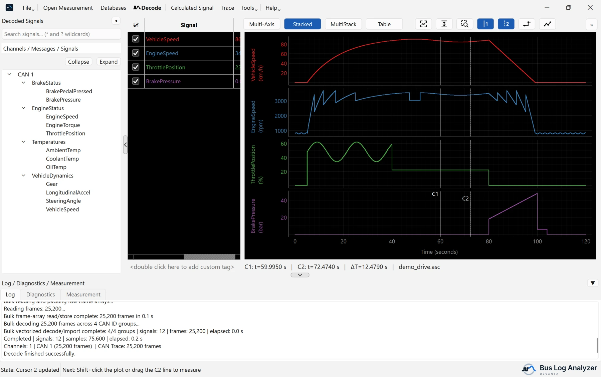
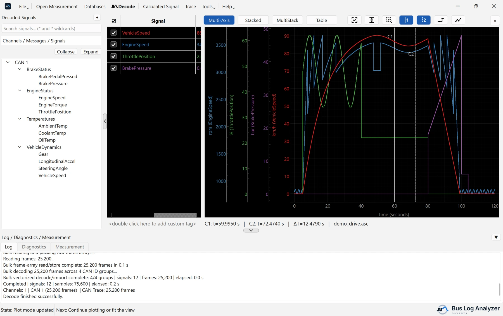
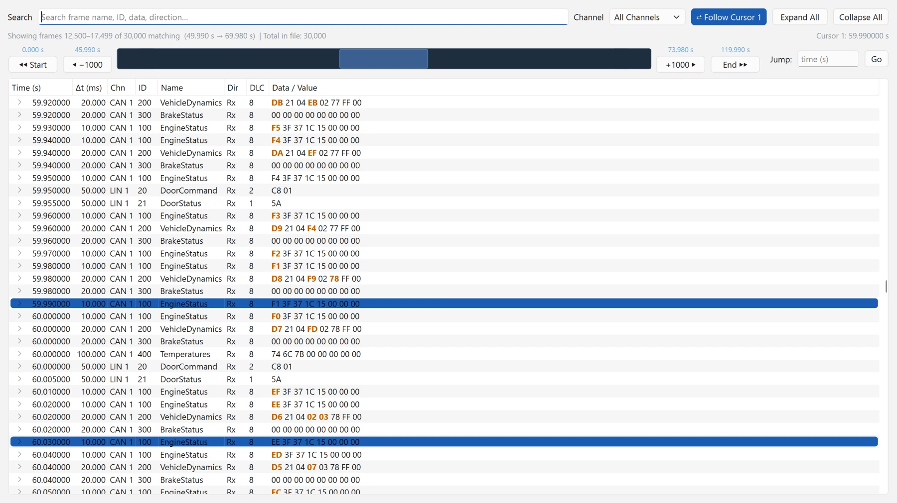

# Osvanta Bus Log Analyzer

> A portable Windows application for loading automotive measurements, decoding CAN and LIN signals, inspecting raw frames, and plotting signal data interactively.

> **User guide:** [osvanta.github.io/bus-log-analyzer](https://osvanta.github.io/bus-log-analyzer/),
> or **Help ▸ Getting started** (`F1`) in the application.
> **Tutorial videos:** [youtube.com/@osvanta](https://www.youtube.com/@osvanta).

> Formerly released as **CANScope**. The repository moved to
> [github.com/osvanta/bus-log-analyzer](https://github.com/osvanta/bus-log-analyzer)
> in August 2026.


## Screenshots

The pictures follow your GitHub theme. They show a made-up demo vehicle; nothing in them is real data.

**Stacked** plot, the default: every signal in its own lane, with both cursors on.

<picture>
  <source media="(prefers-color-scheme: dark)" srcset="guide/images/plot-dark.webp">
  
</picture>

**Multi-Axis** plot: the same signals over each other, one axis per unit.

<picture>
  <source media="(prefers-color-scheme: dark)" srcset="guide/images/readme-multi-axis-dark.webp">
  
</picture>

**Trace**: the raw CAN and LIN frames, with the time since each ID's previous frame and its changed bytes highlighted.

<picture>
  <source media="(prefers-color-scheme: dark)" srcset="guide/images/readme-trace-dark.webp">
  
</picture>

## Supported formats

| Measurement | Content | Database |
|---|---|---|
| BLF (`.blf`) | Raw CAN and LIN frames | DBC or ARXML for CAN, LDF for LIN |
| ASC (`.asc`) | Raw CAN and LIN frames | DBC or ARXML for CAN, LDF for LIN |
| TRC (`.trc`) | Raw CAN frames, from PEAK PCAN trace files (PCAN-View, PCAN-Explorer; versions 1.0 to 3.0) | DBC or ARXML |
| MDF4/MDF3 (`.mf4`, `.mdf`) | Raw CAN or LIN bus logging, or pre-decoded signals | Required only for raw bus logging |
| CSV (`.csv`) | Raw CAN export, narrow signals, or wide signals | Required only for raw CAN data |

MDF and CSV content is detected automatically. The Database Manager assigns a DBC, ARXML or LDF database to each bus channel, mixes database formats, shows how well each database matches the frames on its channel, and has an all-channels fallback per bus.

## Current capabilities

- Fast bulk loading and decoding for BLF, ASC, TRC, MDF/MF4, and CSV measurements, in memory that does not grow with the file.
- Searchable channel/message/signal tree with `*` and `?` wildcards, multi-select plotting and drag-and-drop.
- Right-click a signal ▸ **Properties** shows what the database says about it: message and ID, channel, start bit, length, byte order, type, factor, offset, range, unit, multiplexing, value table, comment, and the database file it came from.
- Indexed **Trace** of the raw CAN and LIN frames, with filtering and on-demand signal decode. Its **Δt** column shows the time since the previous frame with the same ID on the same channel, the bytes that changed since that frame are highlighted, and it can follow plot Cursor 1 both ways.
- Formula-based **Calculated Signal** with arithmetic, comparisons, logical expressions, temporal operations, and a stateful diagnostic counter; **Insert function** (`Shift+F3`) lists every function by category, with how to use each. The definitions are saved in configurations.
- **Statistics** in the signal table: Min, Max, Mean, Std dev, RMS and Samples, over the visible range or between the cursors, and the **Δ C2−C1** difference between the cursors; **Hex** shows Cursor 1's value as the raw value on the bus, padded to the signal's length. Right-click the table header to choose the columns.
- **Table**: the plotted signals as a table, right of the plot, a row per sample time.
- Named **markers** on the plot: add one where you right-click or at Cursor 1 (`M`), drag, rename, go to, delete one from the waste bin beside its name in **Go to marker**, or all of them with **Delete Markers** above the plot; they are saved in configurations and written into MF4 exports as events.
- **File ▸ Measurement info** (`Ctrl+I`): the file's format, size, start time and duration, and for MF4 its header, events and attachments. MF4 events can be drawn on the plot.
- Export of the plotted signals to CSV or Excel (`.xlsx`), on a selected signal's timestamps or a recurrence time you enter, or to MF4; **File ▸ Save decoded measurement as MF4** writes every decoded signal.
- **Tools ▸ Convert files**: join, cut and resample measurements, keep chosen signals, and convert between BLF, ASC, MF4 and CSV (TRC as an input). Signal selections can be saved by name and reused on other files, or shared as text files.
- JSON configuration save/load for measurement paths, database mapping, calculated signals, plotted order, groups, colors, line styles, visibility, axes, cursors, markers, and display settings.
- Closing with unsaved changes asks whether to save them, and the next start offers to reopen the last session, even after a crash.
- Two log files for problem reports, opened with **Help ▸ Open the log folder**: the application log and a crash log.

### Plotting

- **Tabs of plots**: each tab has its own signals, signal table and plot mode. **+** adds a tab, a double-click renames one, and `Ctrl+Tab` moves between them. Drag signals from the signal tree onto a tab, or onto **+** for a new one; drag rows from the signal table onto another tab, or right-click them ▸ **Move to tab**. With **Synchronize Tabs** on, the default, every tab shows the same time range and cursors. Markers, measurement events and the signal table's columns are the same in every tab, and configurations and the last session keep every tab.
- **Stacked** is the default mode and gives each signal its own lane and Y scale.
- **Multi-Axis** overlays the signals, with one axis per unit and an optional individual axis per signal.
- **MultiStack** has lanes that each hold several signals; drag signals into a lane to overlay them there. The signal table splits into one part per lane, level with it, so each lane's signals, cursor values and units sit beside it; drag a signal between parts to move it to that lane.
- Dual draggable cursors provide values and delta time; a click on the plot places Cursor 1 there and a Shift+click places Cursor 2. A cursor switched on always appears inside the visible window, and cursors are black on a light plot background and white on a dark one.
- **Rectangle Zoom** (`Z`): drag a box to zoom into it, Shift+drag to zoom out, double-click to see the whole recording.
- Fit-to-window and vertical-fit work across all plot modes while preserving the relevant view range.
- After the plot mode buttons, Fit to Window, Fit Vertical, Rectangle Zoom, the cursors, the line mode, Show Data Points, Hide Line and Delete Markers are black-and-white icons; pointing at one shows its name.
- Signals can be grouped, reordered by dragging, recolored, given a line style (solid, dashed, dotted, dash-dot), hidden, or removed.
- The line-mode button (`S`) switches between **Step Mode**, the default, where each value is held until the next sample, and **Interpolation Mode**, where straight lines join the samples. Its icon shows the mode the plot is in.
- **Show Data Points** uses adaptive markers and thinner lines.
- **Hide Line** is enabled only when data points are shown; when ON, it displays points without signal lines.
- **Delete Markers** is enabled while there are markers; it offers **Delete all markers**, then each marker by name and time to delete it alone.

## Install and run

### Portable release

Download the latest Windows ZIP from [Releases](https://github.com/osvanta/bus-log-analyzer/releases), extract it, and run `BusLogAnalyzer.exe`. No installer or Python installation is required.

### From source

```powershell
git clone https://github.com/osvanta/bus-log-analyzer.git
cd bus-log-analyzer
python -m venv .venv
.\.venv\Scripts\Activate.ps1
python -m pip install -r requirements.txt
python app.py
```

The portable build and CI release build use Python 3.12.

## Basic workflow

1. Select **Open Measurement** (`Ctrl+O`) and choose a supported measurement.
2. If the file contains raw CAN or LIN frames, select **Databases** and assign a DBC, ARXML or LDF database to each channel.
3. Select **Decode** (`F9`).
4. Search the signal tree, then double-click, drag, press `Space`, or use the context menu to plot signals.
5. Use cursors, plot modes, markers, data points, grouping, and fit controls as needed.
6. In the **File** menu, select **Save configuration** to preserve the session, or **Export plotted signals** to write them to CSV, Excel or MF4.
7. Open the **Trace** when the source contains raw CAN or LIN frames.
8. The **Tools** menu converts, joins and cuts measurement files, open or not.
9. The **Help** menu has Getting started (`F1`), the tutorial videos, the keyboard shortcuts (`Ctrl+/`), GitHub Discussions for questions and ideas, GitHub issues for problems and feature requests, the log folder, the user survey, and About.

## Keyboard shortcuts

| Key | Action |
|---|---|
| `F1` | Getting started, in the user guide |
| `Ctrl+/` | Keyboard shortcuts |
| `Ctrl+O` | Open Measurement |
| `F9` | Decode |
| `Ctrl+S` | Save configuration |
| `Ctrl+E` | Export plotted signals |
| `Ctrl+I` | Measurement info |
| `Ctrl+Shift+R` | Open the Trace |
| `Shift+F3` | Insert function, in Calculated Signal |
| `F` | Fit X and Y to all visible data |
| `V` | Fit Y to the current X range |
| `Z` / `Esc` | Rectangle Zoom on or off / leave it |
| `S` | Step Mode or Interpolation Mode |
| `Space` | Plot selected signal-tree entries |
| `C` | Change the selected signal color |
| `R` | Toggle both cursors |
| `M` | Add a marker at Cursor 1 |
| `Ctrl+Tab` / `Ctrl+Shift+Tab` | Next / previous plot tab |
| `Delete` | Remove selected plotted signals |
| `Ctrl+Z` | Undo the last plot action |
| `Ctrl+Shift+-` / `Ctrl+Shift++` | Collapse / expand signal-tree messages |

**Help ▸ Keyboard shortcuts** shows the same list inside the application.

## Test and build

```powershell
python -m pip install -r requirements.txt -r requirements-dev.txt
python -m pytest
```

Build the portable application with:

```powershell
.\build_portable.bat
```

Output is written to `dist\BusLogAnalyzer\`. Pushing a `v*.*.*` tag runs the Windows build workflow and publishes a release ZIP with its SHA-256 sums and a software bill of materials.

## Repository layout

```text
app.py                 Application entry point and version
core/readers/          BLF, ASC, TRC, MDF/MF4, and CSV readers
core/                  Decode, signal storage, statistics, export, conversion, and calculated-signal logic
gui/                   Main window, plots, Database Manager, Trace, dialogs, and the release test
resources/             Application icon and splash assets
guide/, mkdocs.yml     User guide, published to GitHub Pages
docs/                  Project structure and pull request policy
licenses/              Licence texts of the bundled third-party components
tools/                 Protected-path check and the pre-commit hook
tests/                 Pytest regression suite
```

Runtime dependencies are maintained in [requirements.txt](requirements.txt).

## Security and license

Release binaries are currently unsigned, so Windows SmartScreen may show a warning on first launch. What the application writes to disk, and that it opens no network connection of its own, is described in [Security and data handling](https://osvanta.github.io/bus-log-analyzer/security-and-data/) in the user guide; [SECURITY.md](SECURITY.md) says how to report a vulnerability.

Osvanta Bus Log Analyzer is licensed under the [Mozilla Public License 2.0](LICENSE).

MPL-2.0 is a file-level copyleft license. You may use it freely, including
inside commercial and proprietary products, and you may combine these files with
files of your own under any terms you choose. The one obligation is reciprocal:
if you distribute a modified version of a file that carries the MPL notice, the
source of that modified file must be made available under the MPL.

Releases up to and including `v00.00.59` were published under the MIT License and
remain available under those terms — see [LICENSE-MIT](LICENSE-MIT). The change to
MPL-2.0 applies from `v00.00.60` onward.

Osvanta Bus Log Analyzer bundles third-party components under their own licenses, including
LGPL-3.0 components (Qt via PySide6, python-can, asammdf, chardet). They are used
unmodified and remain available from their upstream projects. See
[THIRD_PARTY_NOTICES.md](THIRD_PARTY_NOTICES.md) for the full component list, and
`licenses/` for the complete license texts — both ship inside the portable build.

"Osvanta", "Osvanta Bus Log Analyzer", and the earlier names "CAN Scope" and
"CANScope" are names used by this project. The license grants rights to the
code, not to the project name. Vector, PEAK-System, ASAM and Qt, and their product
names, belong to their owners; see [DISCLAIMER.md](DISCLAIMER.md).
